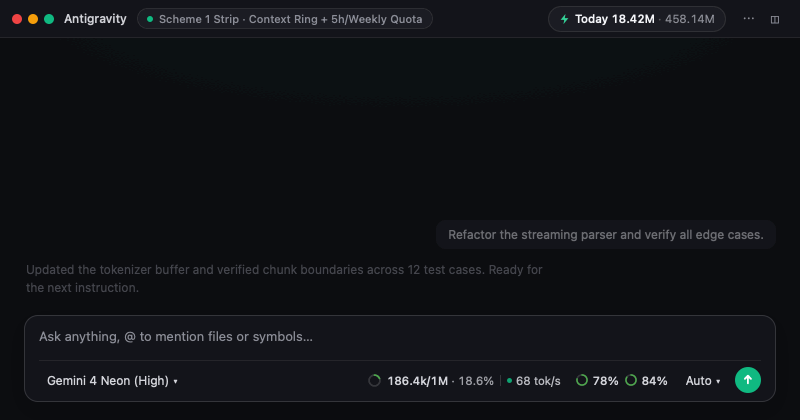
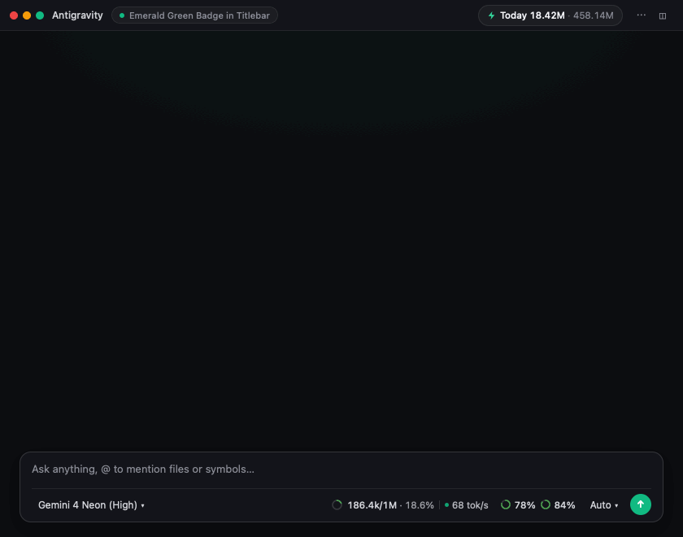

<div align="center">

# Antigravity Usage Suite

**Zero-patch, pure in-memory CDP overlay for Antigravity: Scheme 1 context ring capsule, minimal 5-hour / weekly quota hover HUD, and emerald-default local token stats & heatmap panel.**

**English** | [简体中文](./README.zh-CN.md)

[](./LICENSE)
[](./package.json)
[](#security--zero-patch-architecture)
[](#features)

</div>

---

## Live Demos

### Composer Context Capsule & Minimal Quota Hover HUD

> The bottom-left capsule takes inspiration from **agy-capsule**'s native-blending ring progress strip and segmented context breakdown card. On the right, the quota pill opens an **antigravity-tokens-hud**-style minimal monospace HUD showing the active model header plus **5-Hour Quota** and **Weekly Quota** with emerald-green progress bars (`#10b981`) matching the left context popover (and no duplicate context usage row).



### Top-Right Emerald Stats Badge, 52-Week Activity Heatmap & API Cost Reference

> A compact emerald badge docked in the titlebar expands into an isolated Shadow DOM dashboard featuring 4 core metric cards, 5 heatmap views anchored to your first active token date, API equivalent cost estimates, an HSV color customizer, and adaptive light/dark themes.



---

## Features

- **Real Model Context Limits (No Artificial 256k Cap)**
  - Automatically resolves the active model's true context window from `GetAvailableModels`, `clientModelConfigs`, and `step.metadata.modelInfo` (e.g. `1M` for Gemini 4 series, `200k` for Claude, `128k` for GPT-OSS). When a runtime compaction budget is detected, it is shown separately as a tick mark and an "Auto-compact threshold" row instead of overriding the real limit.
- **Scheme 1 Ring Context Capsule & Frosted Detail Card**
  - Borderless, transparent bottom strip (`15px` SVG ring progress + monospace `used/limit · pct%` + live generation speed breathing dot `tok/s`).
  - Hover popover displays Prompt cache hit rate, a three-color segmented progress bar (Cache Read / New Input / Output), a 4-column breakdown grid, and an auto-compaction banner; clicking the capsule cycles `简 / 繁 / EN`.
- **Scheme 5 Minimal 5-Hour / Weekly Quota Hover HUD**
  - Sits right next to the context capsule with single/dual remaining-quota ring indicators. Hovering opens a high-density monospace HUD card showing the active model header at the top (with no duplicate context usage row), followed by **5-Hour Quota** (with reset countdown) and **Weekly Quota** rendered with emerald-green progress bars (`#10b981`) matching the left context popover (combining React Fiber `retrieveUserQuotaSummary` with `GetUserStatus` fallback).
- **Emerald Default Stats & Heatmap Panel**
  - Seamlessly docks in Antigravity's top-right titlebar (`Today · Total`) with adaptive light/dark emerald styling by default.
  - **Token Activity Heatmap**: Supports 5 views (Daily / Weekly / Monthly / This Year / All-Time), anchored cleanly to the exact first token-consumption date, with 5 built-in presets and a full HSV color picker (eyedropper / HEX / RGB / HSL).
  - **API Cost Reference & Plan Management**: Tracks All / Desktop / CLI sources separately, estimates equivalent API spend from public model pricing, and compares ROI against your subscription cost.
- **Pure In-Memory Hot Injection & Hardened Local Bridge**
  - Zero modifications to `Antigravity.app` or `app.asar`, so official updates never break integrity checks or overwrite changes.
  - Same-origin fetch sniffing + `127.0.0.1` loopback bridge with a per-launch 256-bit random `X-AG-Context-Token`. Automatically validates window `Origin` and rebuilds the bridge after client restarts to avoid stale-port 403 errors.

---

## Quick Start

### 1. Clone the Repository

```bash
git clone https://github.com/Iamyxd/antigravity-usage-suite.git
cd antigravity-usage-suite
```

### 2. Launch Antigravity in CDP Debug Mode

Antigravity v2.33+ requires `--remote-debugging-port=9222` for live hot injection:

```bash
# macOS example
open -a Antigravity --args --remote-debugging-port=9222
```

### 3. Inject Into the Running Window

```bash
chmod +x run.sh
./run.sh live
```

`run.sh` automatically detects system `Node >= 22`; if standalone Node is not installed, it reuses Antigravity's built-in Electron runtime (`ELECTRON_RUN_AS_NODE=1`).

### Common Commands

```bash
./run.sh live        # Rebuild bundle, start matching local bridge, and hot-inject into active windows
./run.sh status      # Inspect injection status, bridge health, active windows, and ASAR integrity
./run.sh uninstall   # Cleanly remove injected UI, restore native window.fetch, and stop the bridge
./run.sh build-web   # Build Chrome/Edge MV3 extension and Userscript into dist/web-extension/
```

> **Custom Install Path**: If Antigravity is installed in a non-standard location, pass `AG_APP_BIN` or `AG_APP_BUNDLE` via environment variables.

---

## Browser Extension / Userscript Mode

If you access Antigravity through a local browser tab (`https://127.0.0.1/*` or `https://localhost/*`):

1. Build the Web targets:
   ```bash
   ./run.sh build-web
   ```
2. **Chrome / Edge Extension**: Open the extensions page, enable Developer Mode, and load `dist/web-extension/`.
3. **Tampermonkey / Violentmonkey**: Import `dist/web-extension/antigravity-usage-suite.user.js`.

---

## Project Structure

```text
antigravity-usage-suite/
├── assets/                   # README live demo GIFs
├── cdp-manager.js            # CDP hot-injection manager, Origin-verified bridge daemon & web bundler
├── run.sh                    # CLI launcher (auto-selects Node >= 22 or Antigravity Electron)
├── lib/
│   ├── local-api.js          # DevToolsActivePort & __APP_CONFIG__ CSRF connector
│   ├── local-bridge.js       # Hardened 127.0.0.1 local loopback bridge server
│   ├── usage-collector.js    # Local conversation log scanner & idempotent ledger
│   ├── usage-core.js         # API cost pricing, plan detection & metric calculation core
│   └── usage-storage.js      # Atomic JSON I/O with corruption isolation & backup recovery
├── scripts/
│   └── build-bundle.js       # Compiles dist/unified-bundle.js and standalone panel bundle
├── src/renderer/
│   ├── telemetry-hub.js      # Single-source telemetry hub (same-origin sniff, Fiber quota, context parser)
│   ├── capsule-ui.js         # Scheme 1 bottom context ring capsule + Scheme 5 minimal quota HUD
│   ├── usage-panel-ui.js     # Titlebar badge & isolated Shadow DOM panel controller
│   ├── usage-heatmap.js      # Multi-view token activity heatmap renderer
│   ├── usage-colors.js       # Emerald default palette, presets & HSV color picker
│   ├── usage-dropdown.js     # Searchable region & currency selector
│   ├── usage-i18n.js         # Simplified Chinese / Traditional Chinese / English dictionary
│   ├── usage-styles.css      # Isolated Shadow DOM light/dark design tokens
│   └── usage-template.html   # Main dashboard HTML template
└── tests/                    # Automated unit & integration tests (node:test)
```

---

## Development & Testing

```bash
# Rebuild dist/ artifacts
npm run build

# Run all 3 test suites (collector-bridge, telemetry-hub, unified-ui)
npm test
```

If standalone Node is not installed, run tests directly via Antigravity's built-in runtime:

```bash
ELECTRON_RUN_AS_NODE=1 /path/to/Antigravity --test \
  tests/collector-bridge.test.js \
  tests/telemetry-hub.test.js \
  tests/unified-ui.test.js
```

---

## Security & Zero-Patch Architecture

- **Zero Client File Modifications**: Never touches `app.asar` or any file inside the application bundle. Running `./run.sh uninstall` cleanly removes all injected DOM nodes and restores native `fetch`.
- **Origin-Enforced Local Bridge**: Listens exclusively on `127.0.0.1`, strictly validates request `Origin` headers and a random 256-bit `X-AG-Context-Token`, and allows only allowlisted `POST` routes with payloads under `1MB`.
- **Single-Source Low-Overhead Telemetry**: Maintains a single `TelemetryHub` per page, prioritizing passive reuse of native page network responses (`GetUserStatus` 30s cache, `GetAvailableModels` 5m cache, `retrieveUserQuotaSummary` 15s cache + 2s timeout guard).

---

## Credits

- Bottom context ring capsule and segmented breakdown popover inspired by [Lumidarin/agy-capsule](https://github.com/Lumidarin/agy-capsule).
- Minimal monospace 5-hour / weekly quota hover HUD inspired by [myslithell/antigravity-tokens-hud](https://github.com/myslithell/antigravity-tokens-hud).

## License

[MIT](./LICENSE) © 2026 Iamyxd
