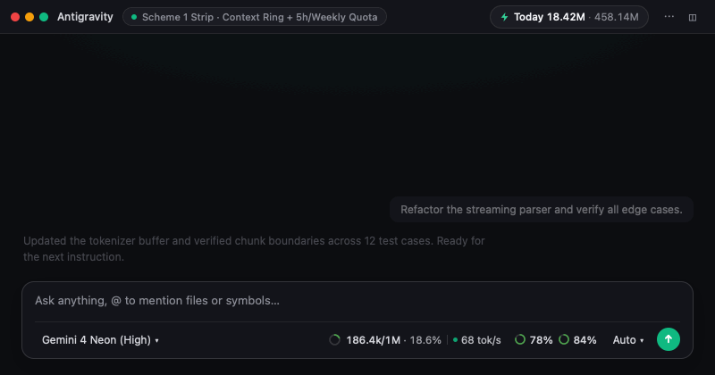
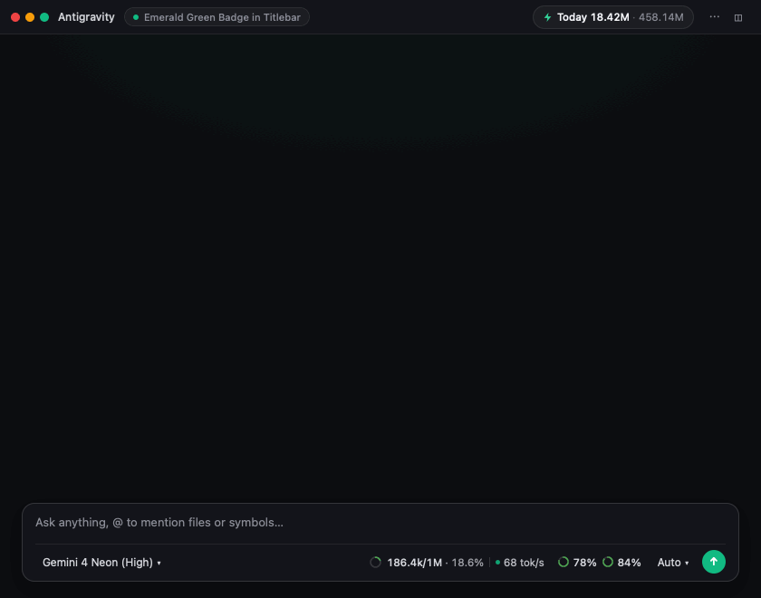

<div align="center">

# Antigravity Usage Suite

**零侵入纯内存 CDP 插件：方案一环形上下文胶囊、极简 5 小时/每周额度悬浮 HUD，以及默认翠绿配色的本地 Token 统计与热力图面板。**

[English](./README.md) | **简体中文**

[](./LICENSE)
[](./package.json)
[](#安全与零侵入架构)
[](#核心特性)

</div>

---

## 效果演示

### 输入框底部上下文胶囊与极简额度悬浮 HUD

> 底部胶囊参考 **agy-capsule** 的原生融入环形进度条与多段上下文拆分卡；右侧额度胶囊悬停采用 **antigravity-tokens-hud** 极简等宽 HUD，顶部展示当前激活模型标题，下方以与左侧上下文弹层一致的翠绿进度条（`#10b981`）呈现 **5 小时额度** 与 **每周额度**（不再重复展示上下文占用行）。



### 右上角翠绿统计徽章、52 周活动热力图与 API 参考费用

> 标题栏紧凑翠绿徽章可展开为 Shadow DOM 仪表盘，包含 4 项核心指标卡片、起始使用日对齐的 5 种维度热力图、API 参考折算费用、自定义调色器以及深/浅色主题自适应。



---

## 核心特性

- **真实模型上下文上限（拒绝 256k 假封顶）**
  - 自动从 `GetAvailableModels`、`clientModelConfigs` 与 `step.metadata.modelInfo` 读取当前模型真实窗口上限（如 Gemini 4 系列 `1M`、Claude `200k`、GPT-OSS `128k`）；若检测到运行时压缩预算，则单独作为刻度线与「自动压缩阈值」行展示，不覆盖真实上限。
- **方案一环形上下文胶囊与毛玻璃明细卡**
  - 无边框透明融入式底部条（`15px` 环形 SVG 进度 + 等宽 `已用/上限 · 百分比` + 实时生成速度呼吸点 `tok/s`）。
  - 悬停展示 Prompt 缓存命中率、三色分段进度条（缓存读取 / 新入 / 输出）、四列竖线拆分网格、自动压缩检测横幅，支持点击胶囊一键切换 `简 / 繁 / EN`。
- **方案五极简 5 小时 / 每周额度悬浮 HUD**
  - 紧邻上下文胶囊显示单/双环形剩余额度图标，悬停弹出高密度等宽 HUD 卡片：顶部仅展示当前激活模型标题（不再重复展示上下文占用行），下方使用与左侧上下文弹层一致的翠绿进度条（`#10b981`）依次呈现 **5 小时额度**（含重置倒计时）与 **每周额度**（结合 React Fiber `retrieveUserQuotaSummary` 与 `GetUserStatus` 自动回退）。
- **默认翠绿配色统计与热力图面板**
  - 在 Antigravity 右上角标题栏无缝停靠（`今日 · 累计`），默认采用翠绿（Emerald）深浅双主题配色。
  - **Token 活动热力图**：支持按天 / 按周 / 按月 / 今年 / 累计 5 种视图，网格精确从首次消耗 Token 之日开始填充，内置 5 套预设色阶与支持取色器 / HEX / RGB / HSL 的 HSV 调色盘。
  - **API 参考金额与套餐管理**：支持按「全部 / 桌面端 / CLI」分源统计，按公开单价估算同等调用折算费用，并与订阅实付对比 ROI。
- **纯内存热注入与安全加固本地桥**
  - 零修改 `Antigravity.app` 与 `app.asar`，官方更新不会破坏校验或被覆盖。
  - 同源网络嗅探 + `127.0.0.1` 回环桥接服务，每次启动生成 256-bit 随机 `X-AG-Context-Token`，重启客户端后自动校验窗口 `Origin` 并重建 bridge，杜绝跨源或过期端口导致的 403 空数据问题。

---

## 快速开始

### 1. 克隆仓库

```bash
git clone https://github.com/Iamyxd/antigravity-usage-suite.git
cd antigravity-usage-suite
```

### 2. 以 CDP 调试模式启动 Antigravity

Antigravity v2.33+ 需要携带 `--remote-debugging-port=9222` 才支持热注入：

```bash
# macOS 示例
open -a Antigravity --args --remote-debugging-port=9222
```

### 3. 一键注入运行中的窗口

```bash
chmod +x run.sh
./run.sh live
```

`run.sh` 会自动检测系统中的 `Node >= 22`；若未安装独立 Node，会自动复用 Antigravity 内置 Electron 运行时（`ELECTRON_RUN_AS_NODE=1`）。

### 常用命令

```bash
./run.sh live        # 重新编译产物、启动匹配的本地 bridge 并热注入到当前窗口
./run.sh status      # 查看注入状态、bridge 健康度、已注入窗口及 ASAR 只读完整性
./run.sh uninstall   # 干净卸载界面、恢复原生 window.fetch 并停止本地 bridge
./run.sh build-web   # 构建 Chrome/Edge MV3 扩展包与油猴用户脚本（dist/web-extension/）
```

> **自定义安装路径**：若 Antigravity 安装在非常规目录，可通过环境变量 `AG_APP_BIN` 或 `AG_APP_BUNDLE` 指定路径。

---

## 浏览器扩展 / 油猴脚本模式

如果你通过浏览器打开本地 Antigravity 页面（`https://127.0.0.1/*` 或 `https://localhost/*`）：

1. 构建 Web 产物：
   ```bash
   ./run.sh build-web
   ```
2. **Chrome / Edge 扩展**：打开扩展管理页启用“开发者模式”，加载 `dist/web-extension/` 目录。
3. **Tampermonkey / Violentmonkey**：直接导入 `dist/web-extension/antigravity-usage-suite.user.js`。

---

## 目录结构

```text
antigravity-usage-suite/
├── assets/                   # README 动态演示 GIF
├── cdp-manager.js            # CDP 热注入管理、Origin 校验桥接守护与 Web 打包工具
├── run.sh                    # CLI 入口脚本（自动匹配 Node >= 22 或 Antigravity Electron）
├── lib/
│   ├── local-api.js          # DevToolsActivePort 与 __APP_CONFIG__ CSRF 连接器
│   ├── local-bridge.js       # 安全加固的 127.0.0.1 本地桥接服务
│   ├── usage-collector.js    # 本地对话记录扫描与幂等记账账本
│   ├── usage-core.js         # API 参考计价、套餐识别与指标计算核心
│   └── usage-storage.js      # 原子化 JSON 读写与损坏隔离/备份恢复
├── scripts/
│   └── build-bundle.js       # 编译输出 dist/unified-bundle.js 与编译版面板脚本
├── src/renderer/
│   ├── telemetry-hub.js      # 单源遥测中心（同源嗅探、Fiber 额度读取、上下文解析）
│   ├── capsule-ui.js         # 方案一底部环形胶囊条 + 方案五极简额度悬浮 HUD
│   ├── usage-panel-ui.js     # 右上角标题栏徽章与 Shadow DOM 主面板控制器
│   ├── usage-heatmap.js      # 多维度 Token 活动热力图渲染引擎
│   ├── usage-colors.js       # 翠绿默认配色、预设色阶与 HSV 调色盘
│   ├── usage-dropdown.js     # 可搜索地区/币种下拉组件
│   ├── usage-i18n.js         # 简体中文 / 繁体中文 / English 三语词典
│   ├── usage-styles.css      # 隔离的 Shadow DOM 深浅双主题设计 Token
│   └── usage-template.html   # 主面板 HTML 模板
└── tests/                    # 自动化单元测试与集成测试（node:test）
```

---

## 开发与测试

```bash
# 重新编译 dist/ 产物
npm run build

# 运行全部 3 个测试套件（collector-bridge、telemetry-hub、unified-ui）
npm test
```

如果系统未单独安装 Node，可直接通过 Antigravity 内置运行时执行测试：

```bash
ELECTRON_RUN_AS_NODE=1 /path/to/Antigravity --test \
  tests/collector-bridge.test.js \
  tests/telemetry-hub.test.js \
  tests/unified-ui.test.js
```

---

## 安全与零侵入架构

- **不改客户端文件**：全程不修改 `app.asar` 或安装包内任何文件，执行 `./run.sh uninstall` 即可彻底移除注入节点并还原原生 `fetch`。
- **Origin 强校验桥接**：本地服务仅监听 `127.0.0.1`，严格校验请求头 `Origin` 与随机 256-bit `X-AG-Context-Token`，仅放行 `POST` 白名单路由与 `1MB` 内请求体。
- **单源低开销遥测**：每页仅维护单一 `TelemetryHub`，优先复用页面原生网络响应（`GetUserStatus` 30s 缓存、`GetAvailableModels` 5m 缓存、`retrieveUserQuotaSummary` 15s 缓存 + 2s 超时保护）。

---

## 致谢与灵感参考

- 底部上下文环形胶囊与分段拆分弹层设计灵感参考自 [Lumidarin/agy-capsule](https://github.com/Lumidarin/agy-capsule)。
- 极简等宽 5 小时 / 每周额度悬浮 HUD 风格参考自 [myslithell/antigravity-tokens-hud](https://github.com/myslithell/antigravity-tokens-hud)。

## 开源协议

[MIT](./LICENSE) © 2026 Iamyxd
